<div align="center">


# CrashCart

**A fictional online store built to be broken on purpose, and a QA pipeline that proves it catches every break.**

[](https://github.com/kartikey3112/crash-cart/actions/workflows/ci.yml)


| 🛒 **Live store** | 📊 **Live results dashboard** | 📘 **API docs** | ⚙️ **CI runs** |
|:---:|:---:|:---:|:---:|
| [crash-cart-two.vercel.app](https://crash-cart-two.vercel.app) | [kartikey3112.github.io/crash-cart](https://kartikey3112.github.io/crash-cart/) | [Swagger UI](https://crashcart-api.onrender.com/docs) | [GitHub Actions](https://github.com/kartikey3112/crash-cart/actions) |

<sub>The backend runs on Render's free tier and sleeps when idle, so the first request after a quiet spell can take up to a minute.</sub>

</div>

---

## Contents

- [Why this exists](#-why-this-exists)
- [See it](#-see-it)
- [By the numbers](#-by-the-numbers)
- [Architecture](#-architecture)
- [Bug switches: proving the tests work](#-bug-switches-proving-the-tests-work)
- [Test strategy](#-test-strategy)
- [The CI pipeline](#-the-ci-pipeline)
- [Run it locally](#-run-it-locally)
- [Repository map](#-repository-map)
- [Lessons from real failures](#-lessons-from-real-failures)
- [Tech stack](#-tech-stack)

---

## 🎯 Why this exists

A green test suite proves very little on its own. Tests that pass might be checking the
right things, or they might be checking nothing at all. CrashCart answers the question
directly:

1. **A real app to test.** A small but complete store: catalog search, filters,
   pagination, accounts, cart, coupons, demo checkout, order history and an admin area.
2. **Bugs you can switch on.** Eleven realistic defects, such as wrong rounding,
   broken authorization and a slow endpoint, are built in. They can be enabled **per
   request** with a secret token. Real visitors always get the correct store.
3. **Tests across every layer.** API, UI and performance suites run against the
   **deployed** store, plus unit tests of the backend code.
4. **Proof, published.** CI runs everything on every push and every night, and publishes
   the results to a public dashboard. A manual run with bug switches on shows each
   injected bug being caught by the tests written for it.

> **Every number in this README comes from a real run.** You can check each one on the
> [results dashboard](https://kartikey3112.github.io/crash-cart/) or in the
> [Actions history](https://github.com/kartikey3112/crash-cart/actions).

---

## 👀 See it

<table>
  <tr>
    <td width="50%">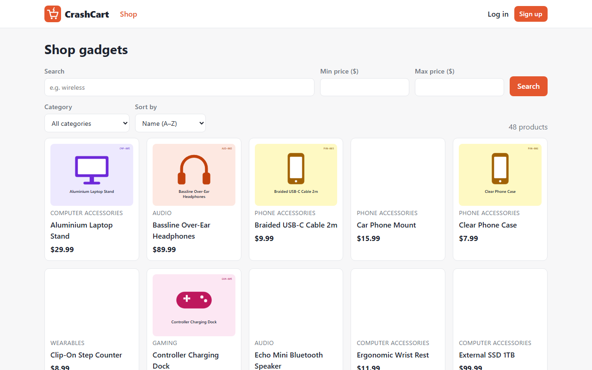</td>
    <td width="50%">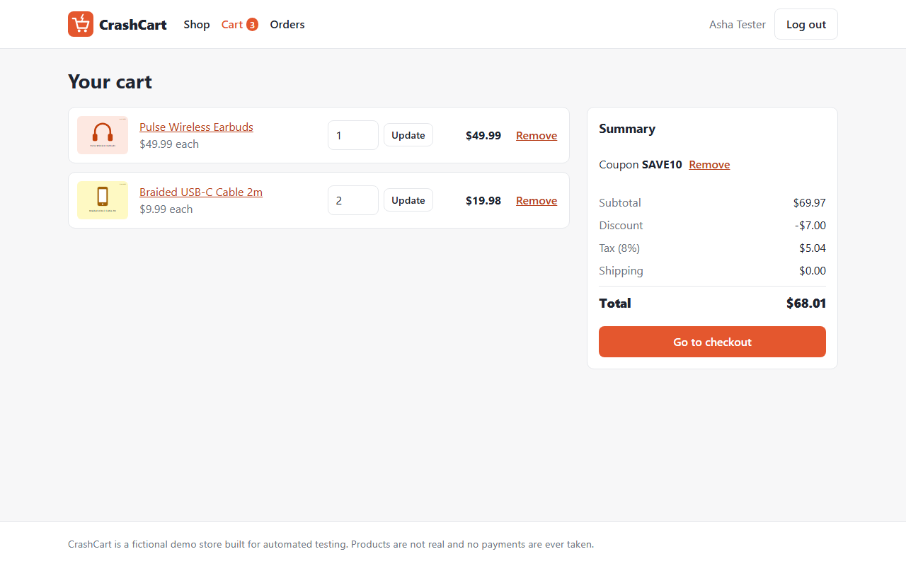</td>
  </tr>
  <tr>
    <td align="center"><sub><b>The store:</b> search, category and price filters, sorting, pagination</sub></td>
    <td align="center"><sub><b>The cart:</b> coupon applied; totals calculated by the server</sub></td>
  </tr>
</table>

<p align="center">
  <picture>
    <source media="(prefers-color-scheme: dark)" srcset="docs/images/dashboard-overview-dark.png" />
    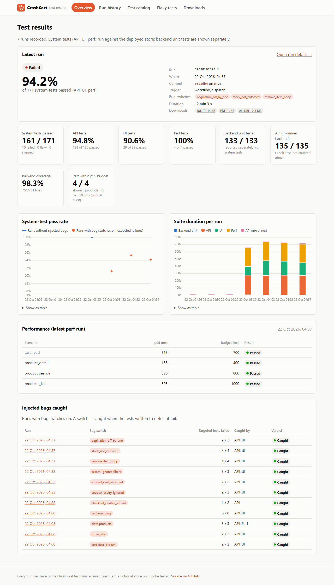
  </picture>
  <br />
  <sub><b>The results dashboard</b> (follows your light/dark theme): latest run, pass-rate and duration trends, perf, and every injected bug caught.</sub>
</p>

<details>
<summary><b>More screenshots</b> (product page, demo checkout, run detail, bug coverage)</summary>
<br />

| | |
|---|---|
| 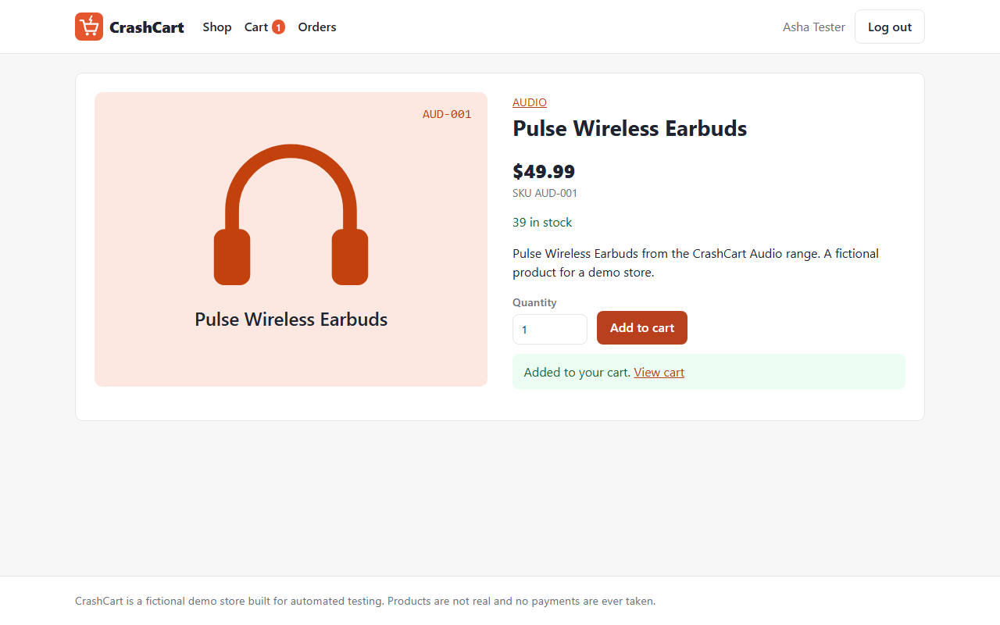 | 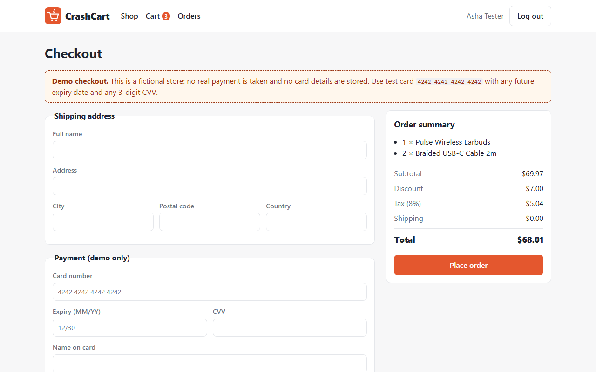 |
| <sub>Product page, after adding to the cart</sub> | <sub>Demo checkout. No real payment is ever taken.</sub> |
| 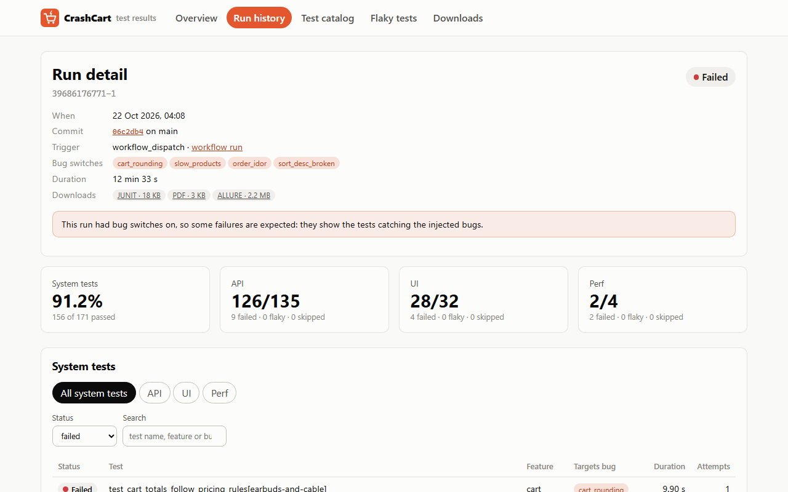 | 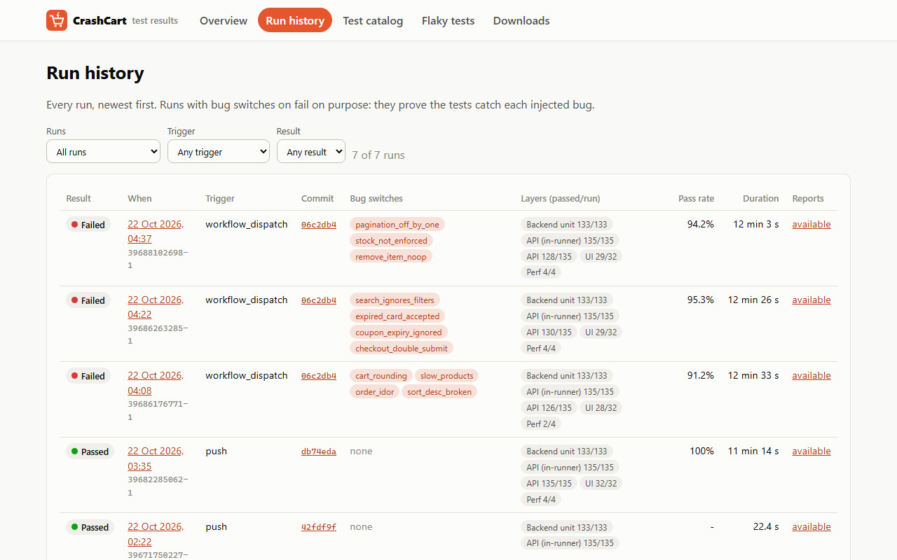 |
| <sub>A run with 4 bug switches on: failures first, each with trace and screenshot links</sub> | <sub>Run history, filterable by bug switches, trigger and result</sub> |

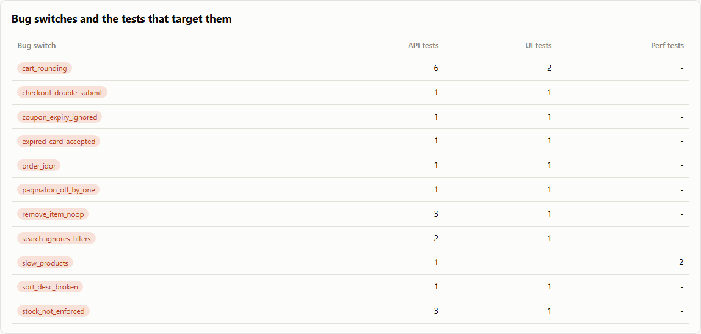
<p align="center"><sub>Test catalog: which layer's tests target each bug switch</sub></p>

</details>

---

## 📈 By the numbers

| | |
|---|---|
| **394** automated tests | 133 backend unit · **171 system** (135 API · 32 UI · 4 perf) · 58 pipeline · 32 dashboard |
| **11 / 11** injected bugs caught on the **live** system | 3 manual CI runs, 0 unexpected failures ([details](#-bug-switches-proving-the-tests-work)) |
| **98.3%** backend line coverage | unit tests plus the API suite, run under coverage in CI (751/761 lines) |
| **13 min 28 s** for a full CI run | self-test, live API, UI and perf suites, publish and deploy ([run 39682285062](https://github.com/kartikey3112/crash-cart/actions/runs/39682285062)) |
| **0** flaky tests | in every run without injected bugs so far ([live count](https://kartikey3112.github.io/crash-cart/flaky.html)). UI tests get one retry; a pass on retry is reported as flaky. |
| **3** browsers | UI suite passed 32/32 on Chromium, Firefox and WebKit. CI uses Chromium automatically; other browsers on demand. |
| **142–489 ms** p95 on Render's free tier | first full run, JMeter, 10 users × 60 s per scenario. Budgets of 400–1000 ms fail the run on regression. |
| **$0** | Render free, Vercel Hobby, GitHub Pages and GitHub Actions |

---

## 🏗 Architecture

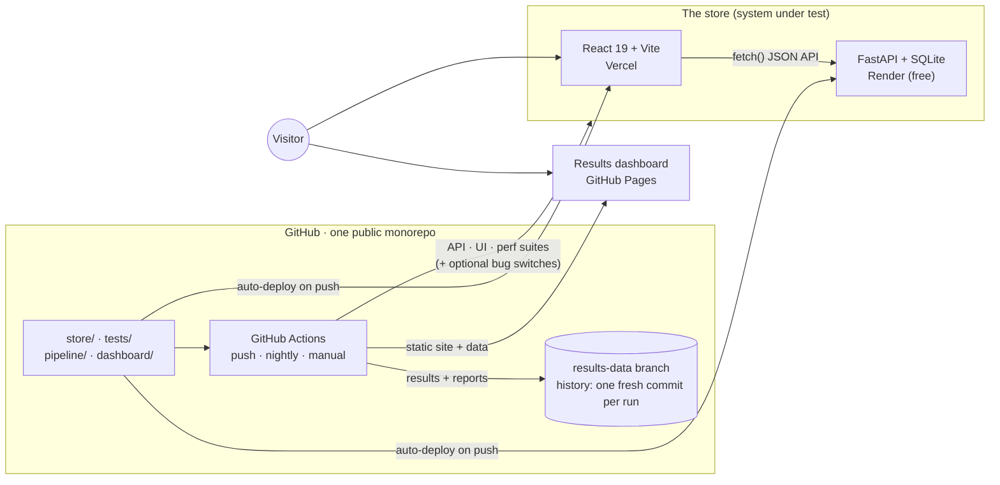

| Piece | Host | Notes |
|---|---|---|
| **Store backend** | Render free web service ([`render.yaml`](render.yaml)) | FastAPI, JWT auth, SQLite re-seeded with fixed data on every start, `/health` reports the deployed commit |
| **Store frontend** | Vercel Hobby | React 19 + TypeScript, every interactive element has a stable `data-testid`, `/version.json` reports the build commit |
| **Results dashboard** | GitHub Pages | Plain HTML/CSS/JS with no build step, reading the JSON the pipeline writes |
| **History** | `results-data` branch | Data and the last 30 runs' reports, force-pushed as one commit so it never grows |

---

## 🐞 Bug switches: proving the tests work

The backend has **11 defects built in, all switched off**. A request turns some on only if
it carries **both** headers:

```http
X-Bug-Switches: cart_rounding,order_idor
X-Test-Token:   <secret, known only to the server and CI>
```

Without a valid token the switches header is ignored, so visitors always get the correct
store. With a valid token, a misspelled switch name is a `400`, so a typo can't silently
test nothing.

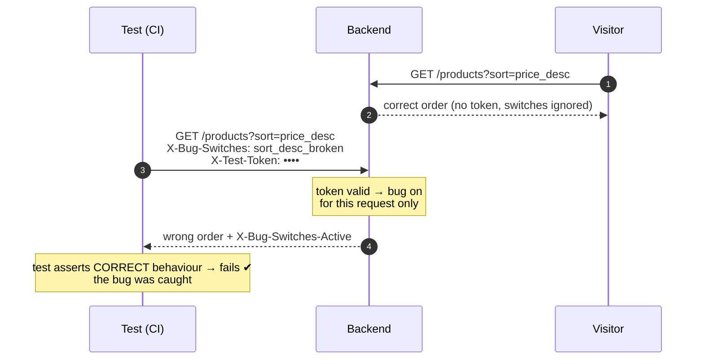

Tests **assert correct behaviour**, so they pass on the healthy store and fail when their
bug is switched on. A manual CI run with bug switches set does exactly that against the live
deployment. Results from the three proof runs:

<details open>
<summary><b>All 11 switches, and the tests that caught them on the live system</b></summary>
<br />

| Bug switch | What breaks | Caught by |
|---|---|---|
| `cart_rounding` | Tax and discount truncated instead of rounded half-up | **8/8** targeted tests · API + UI |
| `slow_products` | `GET /products` sleeps about 2 s | **3/3** · API + **perf** (p95 2,130 ms vs a 1,000 ms budget) |
| `order_idor` | Any user can read another user's order | **2/2** · API + UI |
| `sort_desc_broken` | "Price: high to low" sorts ascending | **2/2** · API + UI |
| `search_ignores_filters` | Category/price filters dropped when searching | **3/3** · API + UI |
| `expired_card_accepted` | Checkout skips the card expiry check | **2/2** · API + UI |
| `coupon_expiry_ignored` | Expired coupons accepted | **2/2** · API + UI |
| `checkout_double_submit` | `Idempotency-Key` ignored, so retries create duplicate orders | **1/2** · API ¹ |
| `pagination_off_by_one` | Page N+1 repeats the last product of page N | **2/2** · API + UI |
| `stock_not_enforced` | Cart quantity can exceed stock | **4/4** · API + UI |
| `remove_item_noop` | "Remove" returns 204 but the item stays | **4/4** · API + UI |

<sub>¹ The UI double-submit test passed in that run. Against the deployed store, network
latency lets the first checkout empty the cart before the second request arrives, so a
browser can't trigger this bug reliably. The API test (which refills the cart between
retries) catches it every time, and the UI test is no longer tagged as a detector for this
switch.</sub>

</details>

<details>
<summary><b>Try it yourself, locally</b></summary>
<br />

With the backend running locally (dev token `dev-test-token`):

```bash
# correct: most expensive first
curl "http://127.0.0.1:8000/products?sort=price_desc&page_size=3"

# with the bug switched on: cheapest first, and the response says so
curl -i "http://127.0.0.1:8000/products?sort=price_desc&page_size=3" \
  -H "X-Bug-Switches: sort_desc_broken" -H "X-Test-Token: dev-test-token"

# prove every switch against the API suite: baseline, then one run per switch
python -m tests.tools.prove_bug_switches --suite tests/api
```

</details>

---

## 🧪 Test strategy

| Layer | Tests | Tools | Runs against |
|---|---|---|---|
| **Backend unit** | 133 | pytest, FastAPI `TestClient`, in-memory SQLite | the code, in-process |
| **API** | 135 | pytest, httpx, pydantic contracts, xdist (4 workers) | the deployed backend |
| **UI** | 32 | pytest-playwright, page objects | the deployed frontend |
| **Performance** | 4 | JMeter 5.6.3, driven and judged by pytest | the deployed backend |
| **Pipeline** | 58 | pytest with sample inputs | the results tooling |
| **Dashboard** | 32 | Playwright with network interception | a fixed, pipeline-built site |

<details>
<summary><b>API: contracts, an independent oracle, parallel-safe data</b></summary>
<br />

- **Strict response contracts.** Pydantic models with `extra="forbid"`, written from the
  consumer's side and never imported from the backend. A renamed, missing or **leaked**
  field (say, a password hash) fails validation.
- **An independent pricing oracle.** [`tests/api/pricing_oracle.py`](tests/api/pricing_oracle.py)
  recalculates subtotal, discount, 8% tax (half-up) and shipping from the business rules
  rather than trusting the server. That's how `cart_rounding` gets caught to the cent.
- **Boundaries, negatives, auth, idempotency.** Password length 7/8/72/73 bytes,
  `page_size` 0/1/50/51, a tampered JWT, a token signed with another key, one customer
  reading another's order, the same `Idempotency-Key` returning the same order.
- **Parallel-safe by design.** Every test registers its own users, and seeded products have
  fixed roles (one is never bought, one is bought by exactly one test). Assertions use
  properties that always hold ("sorted", "no duplicates", "every seeded SKU appears")
  instead of global counts.
- **Failures explain themselves.** `expect_status` and `expect_error` include the request
  and response body, which is exactly what you see on the dashboard.

</details>

<details>
<summary><b>UI: page objects, API-driven setup, evidence on failure</b></summary>
<br />

- **Page objects** for every page, located only by `data-testid`. Catalog actions wait for
  the actual `/products` response before reading the page, so there are no sleeps.
- **Setup through the API.** Users and carts are created over HTTP and the login token is put
  straight into `localStorage`, so the browser only does what the test is about. Setup
  never carries bug headers, so an injected bug can't break the setup.
- **Bug switches in the browser** through Playwright's `extra_http_headers`.
- **One retry, reported honestly.** A test that passes only on retry is shown as
  **flaky**, never as passed.
- **Evidence.** Each failed attempt keeps a Playwright trace and a screenshot, linked
  from the dashboard, including a one-click "open in Trace Viewer" link.

</details>

<details>
<summary><b>Performance: JMeter with a Python-computed p95 gate</b></summary>
<br />

- **One reusable JMeter plan** ([`endpoint_load.jmx`](tests/perf/jmeter/endpoint_load.jmx)),
  driven by a properties file per scenario: path, users, ramp-up, duration, think time,
  token and bug headers.
- **The gate is computed in Python** from every sample in the `.jtl` file (nearest-rank
  p95), so the number that fails the build is easy to audit, with p50/p99, error rate and
  throughput alongside.
- **Budgets live in repository variables** (set from a measured Render baseline), so they
  can be tuned without code changes.

</details>

<details>
<summary><b>Guard rails that keep the suite honest</b></summary>
<br />

- **Mandatory metadata.** Every test needs a layer marker, a `feature("…")` marker and a
  docstring, and any `bug("…")` must name a real switch. Collection fails otherwise. The
  dashboard's test catalog is generated from these.
- **Wake-up, then reset once.** The session waits for the sleeping free-tier backend, with
  a timeout and a clear error, then resets the data **once** (never from parallel
  workers).
- **Flaky detection** uses two signals: a test changing result on the **same commit**, and
  a pass on retry within a run. Runs with injected bugs are excluded, because those
  failures are deliberate.
- **The dashboard tests its own edge cases with network interception:** a server error, an
  empty history, a blocked chart CDN, and test names containing `<script>`, which must be
  shown as text and never executed.

</details>

---

## ⚙ The CI pipeline

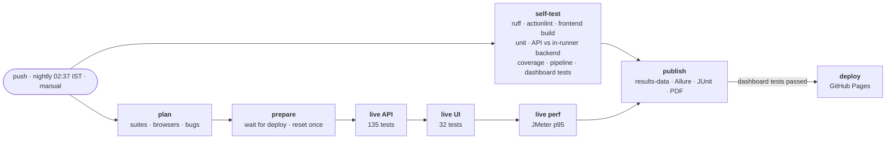

- **The live suites run in sequence on purpose.** API admin tests create products, which
  would shift the pages the UI pagination test compares. Perf runs last so other traffic
  can't skew it.
- **Results are always collected.** Every suite job runs even if the previous one failed,
  and `publish` runs even when tests fail.
- **Waiting for a fresh deploy, per service.** After a push, CI waits until each service runs
  the latest commit that changed **its own folder**, because Render doesn't redeploy for
  docs-only changes.
- **Least privilege.** Every job gets a read-only token, except `publish` (contents: write)
  and `deploy` (pages: write).
- **Supply chain.** JMeter, the Allure CLI and actionlint are downloaded with checksum
  verification, and Chart.js is pinned with a subresource-integrity hash.

<details>
<summary><b>What every run publishes</b></summary>
<br />

- **Per run:** every test's status, duration, attempts, first error line and
  trace/screenshot links. Perf p50/p95/p99, error rate and throughput. Coverage.
- **Downloads** for the newest 30 runs: the Allure HTML report (zip), JUnit XML (zip), and a
  **one-page PDF summary**.
- **Across runs:** the test catalog (every test plus what it checks), and the flaky-test
  analysis (same-commit conflicts, pass-on-retry, 30-day flip rate).

Full details: [docs/ci.md](docs/ci.md) · Deployment: [docs/deployment.md](docs/deployment.md)

</details>

---

## 💻 Run it locally

**You need:** Python 3.14, Node 22 and Git. Java 17 and JMeter 5.6.3 are only needed for the
perf suite.

<details open>
<summary><b>Windows (PowerShell)</b></summary>

```powershell
git clone https://github.com/kartikey3112/crash-cart.git
cd crash-cart
py -3.14 -m venv .venv
.\.venv\Scripts\Activate.ps1
pip install -r store/backend/requirements-dev.txt -r tests/requirements.txt -r pipeline/requirements.txt
python -m playwright install chromium

# Terminal 1: the backend on http://127.0.0.1:8000  (docs at /docs)
cd store/backend; uvicorn app.main:app

# Terminal 2: the frontend's production build on http://localhost:4173
cd store/frontend; npm ci; npm run build; npx vite preview --port 4173

# Terminal 3 (repo root, venv active): run the suites
pytest tests/api -n 4                       # 135 API tests
pytest tests/ui                             # 32 UI tests (add --browser firefox / webkit)
cd store/backend; pytest --cov; cd ../..    # 133 unit tests with coverage

# Build the results dashboard locally, then open http://localhost:8080
python -m pipeline.local_run --suites unit,api,ui
python -m http.server 8080 -d site
```

</details>

<details>
<summary><b>macOS / Linux (bash)</b></summary>

```bash
git clone https://github.com/kartikey3112/crash-cart.git
cd crash-cart
python3.14 -m venv .venv && source .venv/bin/activate
pip install -r store/backend/requirements-dev.txt -r tests/requirements.txt -r pipeline/requirements.txt
python -m playwright install chromium

(cd store/backend && uvicorn app.main:app) &                                         # backend :8000
(cd store/frontend && npm ci && npm run build && npx vite preview --port 4173) &    # frontend :4173

pytest tests/api -n 4 && pytest tests/ui
python -m pipeline.local_run --suites unit,api,ui && python -m http.server 8080 -d site
```

</details>

<details>
<summary><b>Optional: the perf suite</b></summary>

Install Java 17, unzip [JMeter 5.6.3](https://jmeter.apache.org/download_jmeter.cgi) (check
its `.sha512`), and set `JMETER_HOME`, or use the default `~/tools/apache-jmeter-5.6.3`.

```bash
PERF_DURATION_S=20 pytest tests/perf     # 4 scenarios; local p95 is typically under 50 ms
```

</details>

**Demo login:** `demo@crashcart.test` / `demo-password`. **Test card:** `4242 4242 4242 4242`,
any future expiry, any 3-digit CVV. Everything else (configuration, seeded data, coupons)
is in [store/backend/README.md](store/backend/README.md).

---

## 🗺 Repository map

```text
crash-cart/
├── store/
│   ├── backend/        FastAPI app · seed data · 11 bug switches · 133 unit tests · openapi.json
│   └── frontend/       React 19 + Vite + TypeScript · data-testid everywhere · generated SVG art
├── tests/              system tests, run against a live store
│   ├── api/            135 tests · client · pydantic contracts · pricing oracle
│   ├── ui/             32 tests · page objects
│   ├── perf/           JMeter plan + pytest runner (p95 gate)
│   └── tools/          prove_bug_switches.py: baseline, then one run per switch
├── pipeline/           raw results → dashboard data, Allure/JUnit/PDF, retention, flaky analysis
├── dashboard/          static results site (+ its own 32 Playwright tests)
├── docs/               ci.md · deployment.md · images/
├── .github/workflows/  ci.yml
└── render.yaml         backend infrastructure as code
```

Each folder has its own README with details:
[backend](store/backend/README.md) · [frontend](store/frontend/README.md) ·
[tests](tests/README.md) · [pipeline](pipeline/README.md) · [dashboard](dashboard/README.md)

---

## 🔥 Lessons from real failures

Some of the most useful parts of this project came from things that actually broke.

<details>
<summary><b>CI waited 15 minutes for a deploy that was never coming</b></summary>
<br />

The first live run timed out. A push that only changed `dashboard/` redeployed the frontend,
but Render only redeploys when `store/backend` changes, and CI was waiting for the pushed
commit on both services. **Fix:** each service counts as current if it runs the latest
commit that touched **its own folder**, or anything newer, computed with
`git log -- <folder>` and `git rev-list --ancestry-path`. A test reproduces the incident in
a throwaway repo.

</details>

<details>
<summary><b>A UI test claimed to catch a bug it couldn't</b></summary>
<br />

The double-submit test caught `checkout_double_submit` locally but **passed** in the live
proof run. Over the network, the first checkout empties the cart before the second request
lands. Rather than keep a detector that only works sometimes, the test was untagged. It
still checks the user-visible outcome, and the deterministic API test carries the proof.

</details>

<details>
<summary><b>The results branch broke a different deployment</b></summary>
<br />

Every CI run force-pushes `results-data`. Vercel built it as a preview and failed, because
that branch has no frontend, then emailed a failure after every run. **Fix:** Vercel
"Ignored Build Step → Only build production", which now shows as *Canceled by Ignored
Build Step*.

</details>

<details>
<summary><b>Smaller catches before they ever reached CI</b></summary>
<br />

- A job-level environment variable leaked into the unit tests, so one test would have failed
  **only in CI**. Reproduced locally, then scoped to the steps that need it.
- Running the API and UI suites in parallel would have produced false pagination failures,
  so they run in sequence.
- actionlint with ShellCheck found two unused loop variables and an `ls | wc` count, plus a
  comment that ShellCheck read as a directive because it started with `# shellcheck`.
- On Windows, `cmd.exe` treated the `&` in a JMeter URL's query string as a command
  separator, so JMeter settings now go through a properties file.

</details>

---

## 🧰 Tech stack

| Area | Choices |
|---|---|
| **Backend** | Python 3.14 · FastAPI 0.157 · SQLAlchemy 2.1 · pydantic 2.14 · PyJWT · bcrypt |
| **Frontend** | React 19 · react-router 7 · Vite 8 · TypeScript 7 |
| **Testing** | pytest 9 · httpx · pytest-playwright 1.64 · pytest-xdist · pytest-rerunfailures · JMeter 5.6.3 · coverage.py |
| **Reporting** | Allure 2.46 · JUnit XML · fpdf2 (PDF) · Chart.js 4.5 (dashboard) |
| **Quality** | ruff · actionlint + ShellCheck · TypeScript strict |
| **Infra** | GitHub Actions · Render (free) · Vercel (Hobby) · GitHub Pages |

---

<div align="center">

**CrashCart is a fictional store.** Products are invented, the artwork is generated, and no
payment is ever taken.

Built by **Kartikey** · SDET · [github.com/kartikey3112](https://github.com/kartikey3112)

</div>
